# Networkdoc_

Netzwerk-Verkabelung im Browser planen und dokumentieren. Switches, Firewalls, Patchpanels, LWL-Panels, Server, USVs, Access Points und Hosts legst du in Schränken und Räumen an. Ihre Ports verbindest du per Drag & Drop.

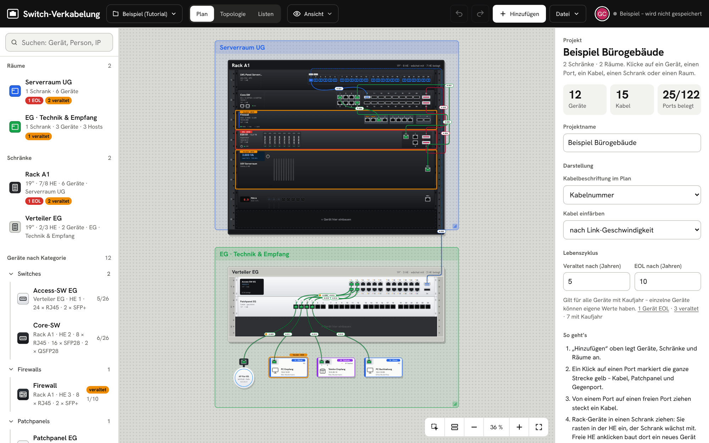

- **Geräte im Stil gängiger Hersteller:** Lancom, UniFi, HP/HPE, FS, Dell, Supermicro, APC, Eaton, CyberPower, Aruba. Bei Firewalls zusätzlich Sophos, Fortinet, Palo Alto, WatchGuard und OPNsense.
- **Ports und Kabel:** RJ45, SFP, SFP+, SFP28, QSFP+ und QSFP28 sowie Patchpanels mit Vorder- und Rückseite. Kabel nach Cat-Standard, Glasfaser (OM1–OM5, OS2), DAC oder AOC, dazu die Transceiver.
- **Port-Nummerierung:** Bei zweireihigen Geräten wählbar: spaltenweise (1 oben, 2 unten oder 2 oben, 1 unten) oder nebeneinander (oben bzw. unten 1, 2, 3 …). Nummern und Beschriftungsfelder liegen immer über den Kabeln.
- **Server-Festplatten:** Anzahl der Slots und davon befüllte, 2,5″ oder 3,5″, vertikal (stehend) oder horizontal (liegend) in bis zu 4 Reihen. Je Platte optional Größe (TB/GB) und Typ (HDD/SSD). Die Summe steht neben dem Servernamen. Weicht eine Platte um mehr als 5 TB vom Median der übrigen ab, wird sie gelb markiert und zählt erst nach dem Quittieren mit. RAID-Verbünde (RAID 0/1/5/6/10/50/60, RAID-Z1–Z3, JBOD) mit Farbe, nutzbarer Kapazität und Prüfungen.
- **Strecke verfolgen:** Ein Klick auf einen Port oder ein Gerät markiert die ganze Strecke gelb, über Patchpanels hinweg bis zum Gegenport.
- **Prüfungen:** Geschwindigkeit, Transceiver-Reichweite, Faser- und Steckertyp, PoE, 100-m-Grenze bei Kupfer, LAG/STP.
- **Lebenszyklus:** Für jedes Gerät lässt sich ein Kaufjahr eintragen. Veraltete Geräte werden orange markiert (Standard: ab 5 Jahren), Geräte am Lebensende (EOL) rot (Standard: ab 10 Jahren). Die Schwellen sind fürs ganze Projekt und pro Gerät einstellbar.
- **Suche und Kategorien:** Die Suche findet Geräte, Personen, IPs und Port-Beschriftungen. Über „Ansicht“ lassen sich ganze Kategorien oder einzelne Räume, Schränke, Geräte und Hosts ausblenden.
- **VLANs und IP-Adressen:** VLANs mit Farbe, Subnetz und Gateway; Ports als Access oder Trunk (Native + getaggt), auch für ganze Portbereiche. Prüfungen entlang der Strecke, doppelte IPs, falsches Subnetz, nächste freie IP. Hosts erscheinen dauerhaft in ihrer VLAN-Farbe, Port-VLANs und RAID-Farben nur am ausgewählten Gerät.
- **Logische Topologie:** automatisch erzeugtes L2-Diagramm ohne Patchpanels, Hosts einzeln, gruppiert oder ausgeblendet, eingefärbt nach Tempo oder VLAN.
- **Stromversorgung:** PDUs, Leistungsaufnahme je Gerät (sonst geschätzt, inkl. PoE), Netzteile A/B an USV oder PDU, Last und Laufzeit der USV, Hinweise bei Überlast oder fehlender Redundanz.
- **Listen:** Kabel, Patchlegung, Geräte, VLANs & IPs, Strom und Materialliste (Patchkabel, Verlegekabel in Metern, Transceiver, Module, Platten) – jeweils als CSV.
- **Mehrfachauswahl:** Umschalt + Klick, Auswahlrahmen, Auswahlmodus für Touch; gemeinsam verschieben, ausrichten, duplizieren, löschen.
- **Vorlagen:** konfigurierte Geräte als eigene Vorlage speichern und wiederverwenden.
- **Versionsverlauf:** benannte Stände, automatische Sicherungen, Vergleich mit dem aktuellen Stand, Wiederherstellen.
- **PDF und Etiketten:** komplette Dokumentation als PDF (Plan, Schränke, Topologie, alle Listen); Etiketten für Kabel, Ports und Geräte auf A4-Bögen, für Etikettendrucker oder als Kabelfahne, wahlweise mit QR-Code. In der Server-Version öffnet der QR-Code das Objekt direkt (`#dev-…`, `#cab-…`, `#port-…`).
- **Patchlegung:** wird automatisch aus dem Plan erzeugt – nach Raum und Schrank gegliedert, je Switch eine Tabelle mit Port, Patch (Kürzel des Patchpanels + Port, z. B. 11.6), VLAN, Geräteklasse und Nutzer. Hat ein Patchpanel-Port eine eigene Beschriftung, steht genau diese in der Spalte Patch; sonst wird sie aus Kürzel und Port gebildet. Das Kürzel lässt sich am Patchpanel festlegen, sonst wird je Schrank von oben durchnummeriert.
- **Export:** Patchliste und Patchlegung als CSV, der Plan als SVG oder PNG, das Projekt als JSON.
- **Deutsch und Englisch:** Der Knopf **DE/EN** oben rechts schaltet die Sprache um. Übersetzt werden Oberfläche, Hinweise, Listen, CSV, PDF-Dokumentation und Etiketten; eigene Namen von Geräten, Räumen oder Plänen bleiben, wie sie sind. Beim ersten Aufruf richtet sich die Sprache nach dem Browser. Die Übersetzungen stehen in `scripts/i18n_en.py`, daraus erzeugt `python3 scripts/i18n_en.py` die Datei `src/i18n-en.js`.
- **Mehrere Pläne:** Oben links wählst du den Plan, legst neue an, benennst um, duplizierst oder löschst. Das mitgelieferte Beispiel bleibt immer als Tutorial erhalten: Darin kannst du alles ausprobieren, gespeichert wird nichts. Mit „Beispiel als eigenen Plan speichern“ wird daraus ein echter Plan. Im Menü siehst du, wer gerade in welchem Plan arbeitet. Ein Link mit `?plan=<id>` öffnet direkt einen bestimmten Plan, die QR-Codes auf Etiketten enthalten ihn automatisch.
- **Live zusammenarbeiten:** Jede Änderung wird sofort gespeichert und erscheint bei allen, die den Plan offen haben. Arbeiten zwei Leute gleichzeitig, werden ihre Änderungen je Gerät, Kabel und Feld zusammengeführt. Gleichzeitige Änderungen an verschiedenen Dingen gehen also nicht verloren; am selben Feld gilt die zuletzt gespeicherte. Oben rechts siehst du, wer gerade im Plan ist. Im Plan erscheinen ihre Mauszeiger mit Namen und Farbe, außerdem das Gerät, das jemand gerade verschiebt, als Umriss an der neuen Stelle, das Kabel, das jemand zieht, und was gerade ausgewählt ist. Rückgängig (Strg+Z) nimmt nur deine eigenen Schritte zurück.
- **Chat und Kommentare:** Der gelbe Knopf unten links öffnet ein Fenster mit zwei Reitern. Im **Chat** schreiben alle, die den Plan offen haben, miteinander; neue Nachrichten zeigt der Knopf mit einer Zahl an. Unter **Kommentare** hängst du Notizen an Geräte – etwa zu einer Änderung, auf die sich der Kommentar dann mit Name und Zeit bezieht. Das Gerät wählst du dort aus einer Liste nach Kategorien mit Suche, oder du klickst in den Eigenschaften eines Geräts auf „Kommentieren“. Kommentare lassen sich als erledigt markieren; Geräte mit offenen Kommentaren tragen im Plan eine gelbe Sprechblase. Auf dem Server liegen Chat und Kommentare je Plan unter `talk/`, im geteilten Artifact in der gemeinsamen Datenbank; ohne Server bleiben sie auf dem eigenen Gerät.
- **Verbindungstest (Ping):** Bei jedem aktiven Gerät wählst du rechts unter „Verbindungstest“ ein Ziel. Ein simuliertes Ping-Paket läuft dann – ähnlich wie im Simulationsmodus von Cisco Packet Tracer – im Plan über Kabel, Patchpanels, Switches und das Gateway zum Ziel und als Antwort zurück. Die Liste daneben zeigt jede Station mit Ein- und Ausgangsport, VLAN (getaggt oder nicht) und Kabelnummern, dazu eine Ping-Ausgabe wie in der Eingabeaufforderung. Kommt das Paket nicht an, steht dort, wo und warum: Port deaktiviert, kein Link, durch RSTP blockiert, VLAN auf dem Trunk nicht erlaubt, falsches Access-VLAN, kein Gateway eingetragen, Router ohne Port im Zielnetz oder eine offene Strecke am Patchpanel. Ohne IP-Adressen geht es auch: Dann wird nur die Route verfolgt – über Kabel, Switches und, wo bekannt, VLANs; passt das VLAN nicht, zeigt es trotzdem den Kabelweg und markiert das Problem. Das Ergebnis aktualisiert sich, sobald du etwas korrigierst. Geprüft wird nur, was dokumentiert ist; Firewall-Regeln und Routing-Tabellen werden nicht nachgebildet, Ports ohne VLAN-Angabe gelten als transparent.
- **Spanning Tree (RSTP):** Für Switches lassen sich RSTP (an/aus), Bridge-Priorität, MAC und je Port die Pfadkosten festlegen. Daraus berechnet die App den Baum wie RSTP im eingeschwungenen Zustand: Root-Bridge, Root-Ports, Designated Ports und blockierte Alternate-/Backup-Ports, mit Pfadkosten nach IEEE 802.1t (oder 802.1D kurz). Blockierte Ports stehen orange im Plan und gestrichelt in der Topologie, auf Wunsch auch alle Rollen und die Kosten je Switch. Budgets: Max Age gilt als Hop-Budget (Standard 20) – Switches, die zu weit von der Root entfernt sind, werden gemeldet –, dazu die Timer-Regel 2 × (Forward Delay − 1) ≥ Max Age ≥ 2 × (Hello + 1) und ein Hinweis, wenn der Durchmesser über 7 Switches liegt. Switches mit ausgeschaltetem Spanning Tree gelten als Hubs; eine Schleife nur über sie wird als Fehler gemeldet. Der Verbindungstest nimmt den Weg, den RSTP offen lässt.
- **Wer hat was angelegt und geändert:** Ganz unten in den Eigenschaften eines Geräts, Kabels, Schranks oder Raums steht, wer es angelegt und wer es zuletzt bearbeitet hat, mit Zeitpunkt. Auf dem Server ist das der Kontoname, ohne Anmeldung der Gastname (z. B. „Gast F03“) oder der Name, den man sich über das eigene Kürzel oben rechts gegeben hat. Verschieben zählt als Bearbeitung, das Mitwandern beim Verschieben eines Raums nicht; ein gestecktes oder gezogenes Kabel zählt bei beiden Geräten.

## Screenshots

Alle Bilder zeigen das Beispielprojekt, das beim ersten Start geladen wird.

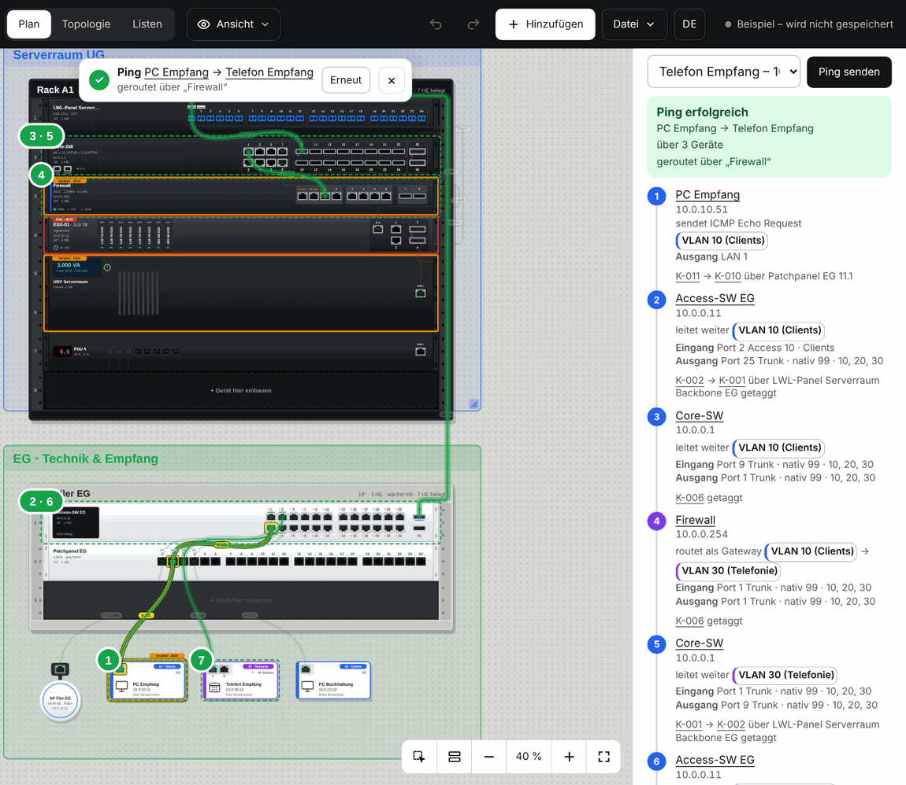

<table>
<tr>
<td width="50%">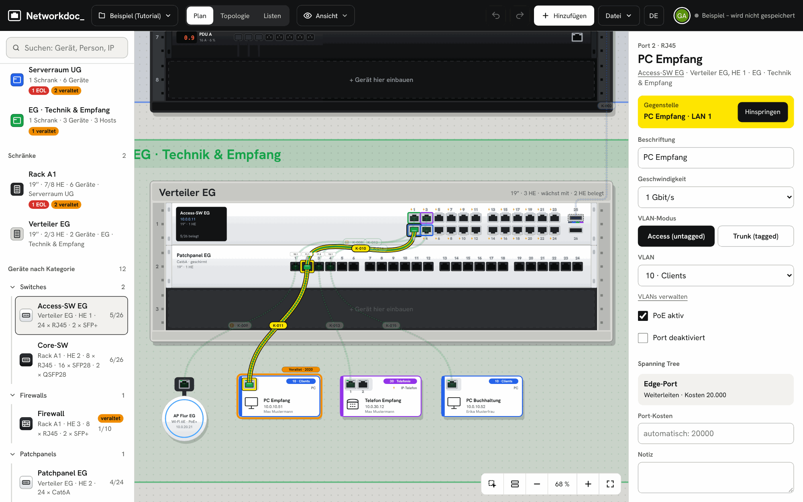<br><b>Strecke verfolgen:</b> Ein Klick auf einen Port markiert den Weg über das Patchpanel bis zum Gegenport, rechts stehen VLAN, PoE und Kabeldaten.</td>
<td width="50%">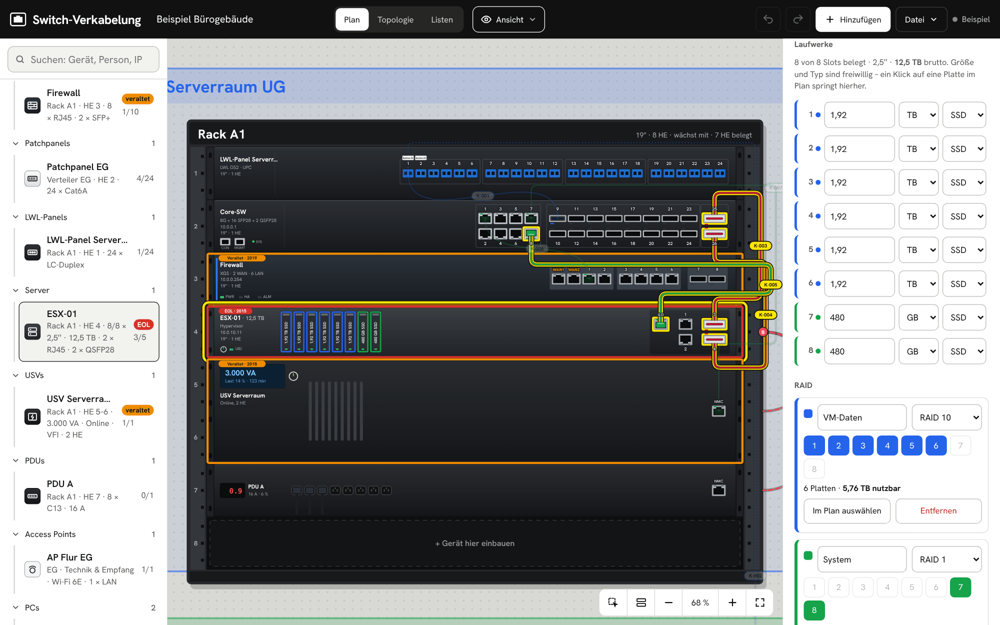<br><b>Server und RAID:</b> Platten mit Größe und Typ, RAID-Verbünde farbig im Plan; Lebenszyklus mit Markierung für veraltet und EOL.</td>
</tr>
<tr>
<td>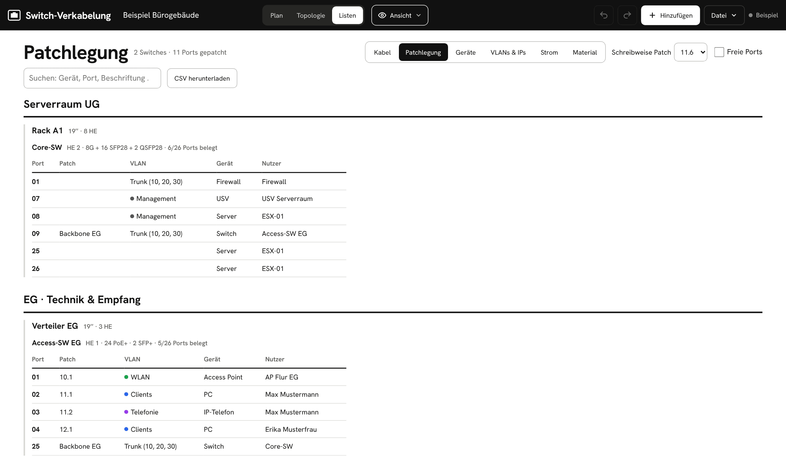<br><b>Patchlegung:</b> je Raum, Schrank und Switch eine Tabelle mit Port, Patch, VLAN, Gerät und Nutzer.</td>
<td>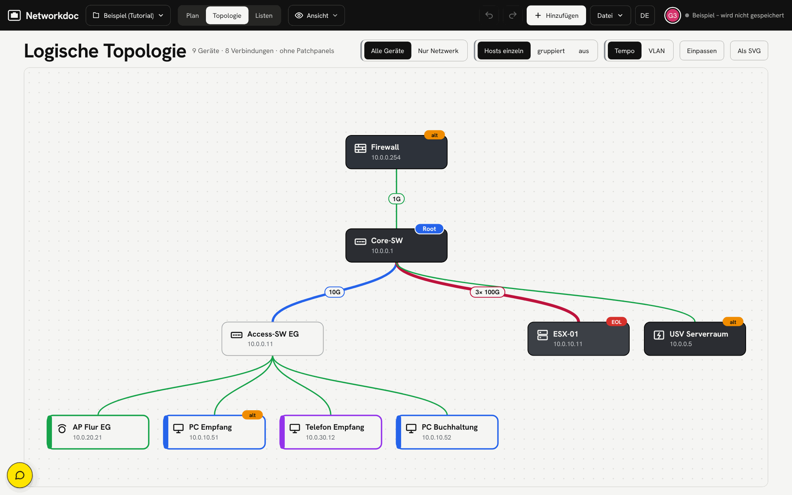<br><b>Logische Topologie:</b> automatisch aus dem Plan erzeugt, eingefärbt nach Tempo oder VLAN.</td>
</tr>
<tr>
<td>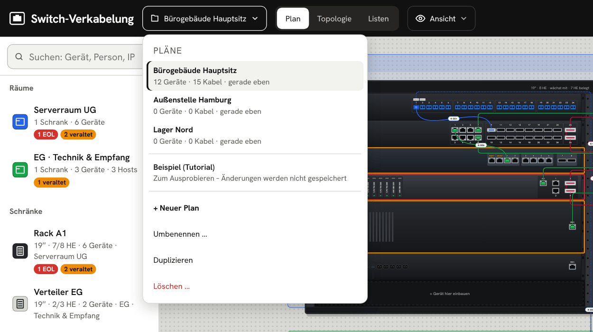<br><b>Mehrere Pläne:</b> oben links wechseln, anlegen, umbenennen, duplizieren oder löschen; das Beispiel bleibt als Tutorial.</td>
<td>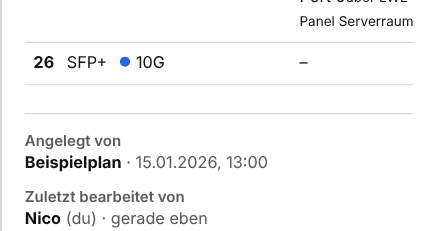<br><b>Angelegt und bearbeitet:</b> ganz unten in den Eigenschaften, mit Name und Zeitpunkt.</td>
</tr>
<tr>
<td>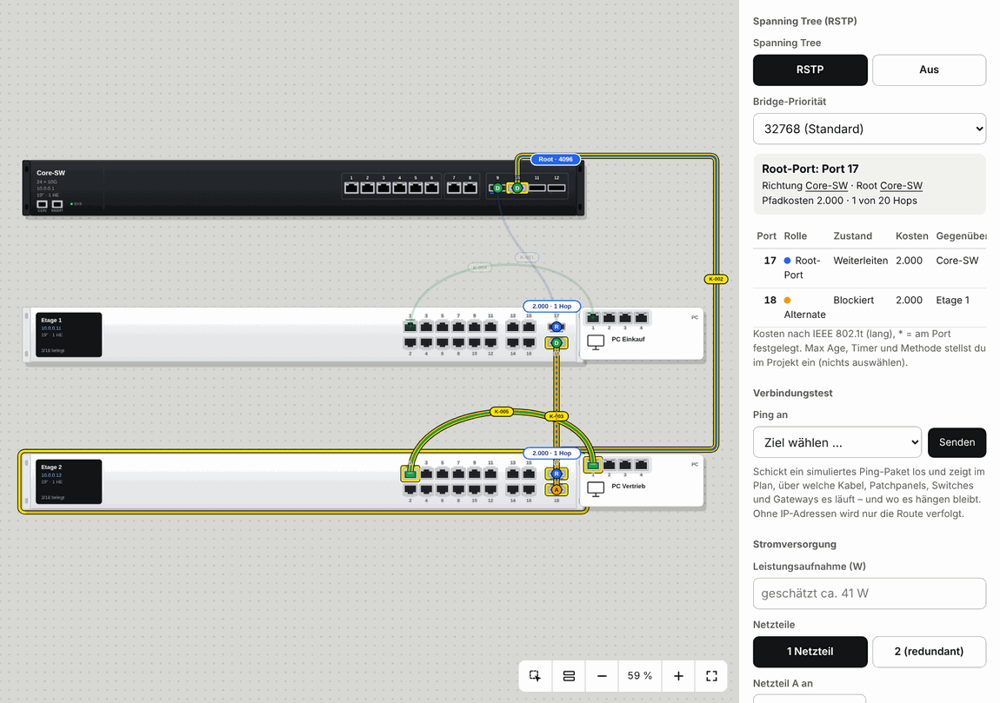<br><b>Spanning Tree (RSTP):</b> Root-Bridge, Port-Rollen, blockierte Ports und Pfadkosten.</td>
<td></td>
</tr>
<tr>
<td>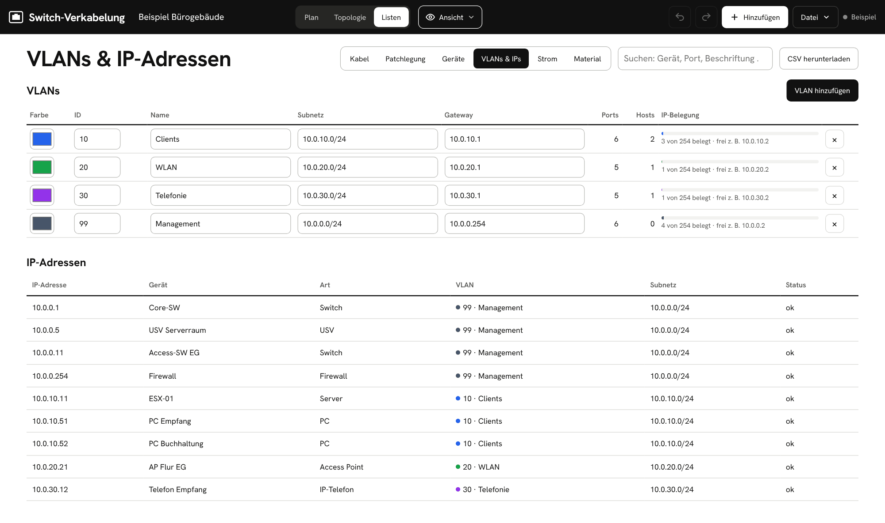<br><b>VLANs und IP-Adressen:</b> Subnetz, Gateway, Belegung und Prüfung jeder IP.</td>
<td align="center">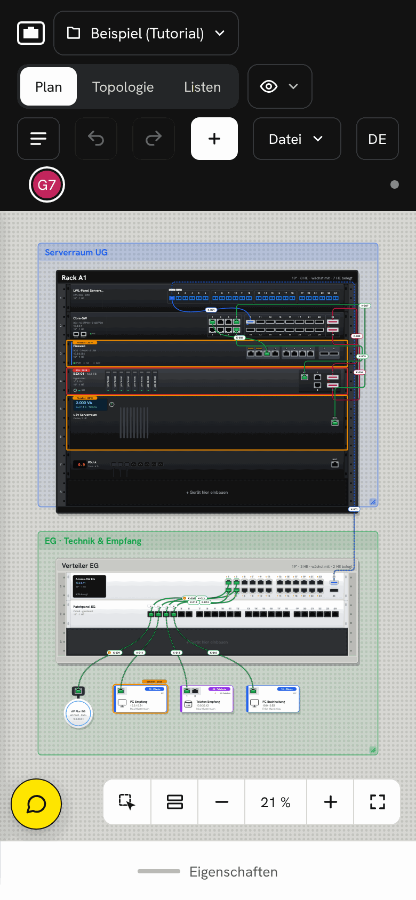<br><b>Auf dem Handy:</b> gleiche Funktionen, Eigenschaften als Leiste von unten.</td>
</tr>
</table>

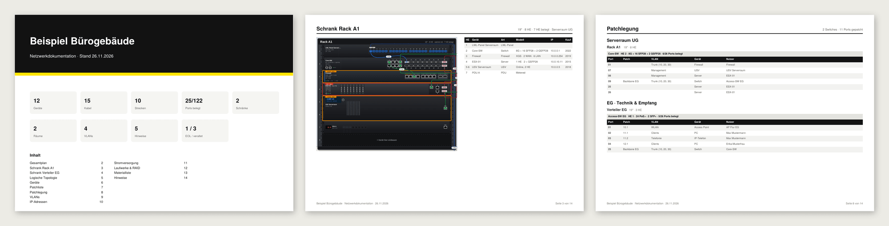

**PDF-Dokumentation:** Deckblatt mit Kennzahlen, Gesamtplan, jeder Schrank, Topologie und alle Listen in einem Dokument.

## Auf einem Server betreiben (Docker)

Voraussetzung sind Docker und Docker Compose.

```bash
git clone https://github.com/theNic0ntr/switch-verkabelung.git
cd switch-verkabelung
docker compose up -d --build
```

Die App läuft danach auf `http://<server>:8080`. Die Pläne werden auf dem Server gespeichert, also im Docker-Volume `daten` unter `/data/plans/<id>.json`, und sind damit in jedem Browser gleich. Ein bisheriges `/data/plan.json` wird beim ersten Start automatisch zum ersten Plan (die alte Datei bleibt als `plan.json.migriert` liegen). Änderungen anderer kommen live über eine dauerhafte Verbindung (`/api/live`, Server-Sent Events) an und werden mit deinen eigenen zusammengeführt.

### Anmeldung einschalten

Ohne Anmeldung kann jeder, der den Server erreicht, den Plan ändern. Trage in `docker-compose.yml` die Konten ein, je Person `name:passwort`, getrennt durch Komma:

```yaml
    environment:
      AUTH_USERS: "nico:ein-langes-passwort,anna:noch-ein-passwort"
```

Danach `docker compose up -d` ausführen. Der Name des Kontos steht bei den anderen am Mauszeiger. Für ein einzelnes Konto gehen weiterhin `AUTH_USER` und `AUTH_PASSWORD`. Ohne Anmeldung legt jeder seinen Namen selbst fest (Klick auf den eigenen Kreis oben rechts). Die Anmeldung läuft über HTTP Basic Auth. Ist der Server von außen erreichbar, gehört davor ein Reverse Proxy mit HTTPS (z. B. Caddy, Traefik oder nginx), sonst gehen die Zugangsdaten unverschlüsselt über das Netz.

Beispiel mit Caddy, das sich automatisch um das Zertifikat kümmert:

```
netz.example.de {
    reverse_proxy 127.0.0.1:8080
}
```

Bei nginx darf die Live-Verbindung nicht gepuffert werden. Der Server schickt dafür `X-Accel-Buffering: no`; bei eigenen Einstellungen zusätzlich für `/api/live` `proxy_buffering off;` und ein langes `proxy_read_timeout` setzen. Fällt die Live-Verbindung aus, holt die App neue Stände alle 30 Sekunden ab.

### Einstellungen

| Variable | Standard | Bedeutung |
|---|---|---|
| `PORT` | `8080` | Port im Container |
| `AUTH_USERS` | – | Mehrere Konten: `name:passwort,name2:passwort2` (Komma oder Zeilenumbruch, kein Komma im Passwort) |
| `AUTH_USER` / `AUTH_PASSWORD` | – | Ein einzelnes Konto, nur zusammen gesetzt |
| `DATA_DIR` | `/data` | Ablage für die Pläne (`plans/`), Chat und Kommentare (`talk/`), Sicherungen (`backups/<id>/`) und gelöschte Pläne (`papierkorb/`) |
| `BACKUPS` | `50` | Anzahl der aufbewahrten Sicherungen (`0` = keine) |
| `BACKUP_MINUTES` | `10` | Höchstens eine Sicherung pro Zeitraum |
| `MAX_PLAN_MB` | `20` | Maximale Größe eines Plans |

### Sicherungen und Wiederherstellen

Vor dem Überschreiben legt der Server je Plan eine Kopie unter `/data/backups/<id>/` ab, höchstens alle 10 Minuten. Benannte Stände aus **Datei → Versionsverlauf** liegen ebenfalls dort (`named-*.json`) und werden nicht automatisch gelöscht. Gelöschte Pläne landen in `/data/papierkorb/`; zum Zurückholen die Datei wieder als `/data/plans/<id>.json` ablegen und den Container neu starten. Zusätzlich kannst du jederzeit über **Datei → Projekt speichern** eine JSON-Datei sichern und über **Datei → Projekt laden** als neuen Plan wieder einspielen.

So kommst du an die Dateien im Volume:

```bash
docker compose cp switch-verkabelung:/data ./sicherung
```

### Aktualisieren

```bash
git pull
docker compose up -d --build
```

Fertige Images für amd64 und arm64 (auch Raspberry Pi) baut GitHub Actions bei jedem Push nach `ghcr.io/thenic0ntr/switch-verkabelung:latest`. Statt `build: .` kannst du in `docker-compose.yml` auch dieses Image verwenden. Für eine feste Version nimmst du statt `latest` den Tag eines Releases, z. B. `ghcr.io/thenic0ntr/switch-verkabelung:v1.0`.

### Ohne Docker

Benötigt wird Node.js ab Version 20. Weitere Pakete sind nicht nötig.

```bash
node scripts/build.mjs
DATA_DIR=./data node server/server.js
```

## Aufbau

```
src/          Quellen der App: head.html, base.css, extra.css, body.html, app.js, Schriften
src/vendor/   jsPDF, jsPDF-AutoTable, qrcode-generator (MIT, werden erst bei Bedarf geladen)
scripts/      build.mjs fügt alles zu einer HTML-Datei zusammen
server/       server.js – liefert die App aus und speichert den Plan (nur Node-Bordmittel)
dist/         Build-Ergebnis (nicht im Repository)
```

`node scripts/build.mjs` erzeugt zwei Varianten:

- `dist/public/` ist die Server-Version mit lokal eingebundenen Schriften. Sie lädt nichts von Google und speichert über `/api/plan`.
- `dist/artifact.html` ist eine Einzeldatei mit Google Fonts, die auch ohne Server läuft und im Browser speichert (localStorage). Als Claude-Artifact veröffentlicht, nutzt sie einen gemeinsamen Plan für alle, mit denen das Artifact geteilt ist, samt Live-Präsenz.

## Lizenz

Code: alle Rechte vorbehalten. Schrift: Hanken Grotesk, SIL Open Font License 1.1 (`src/fonts/OFL.txt`). Mitgelieferte Bibliotheken: MIT, siehe `src/vendor/LICENSES.txt`.
